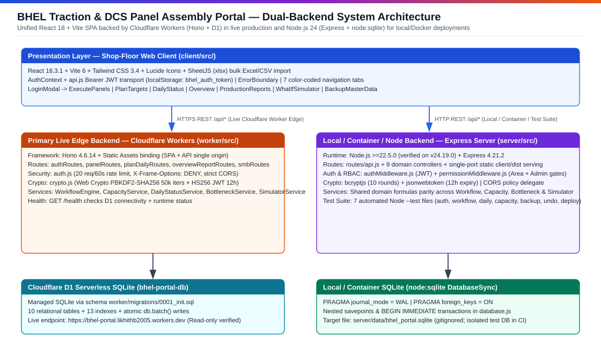
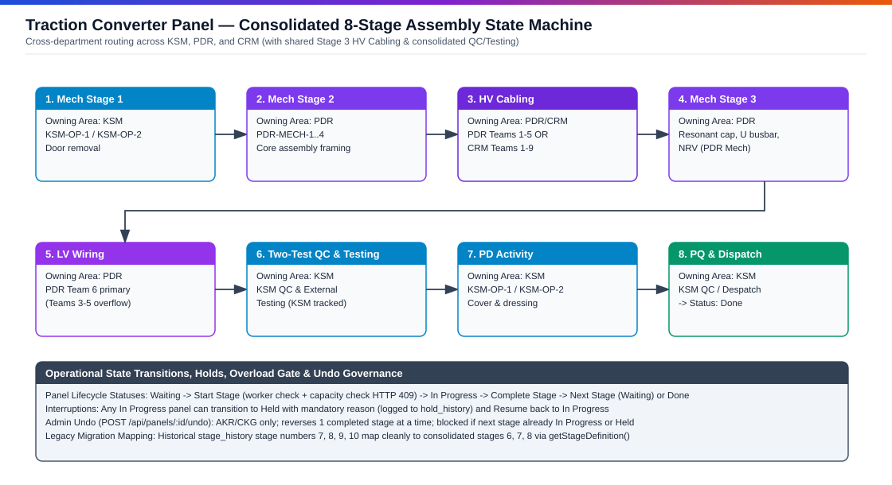
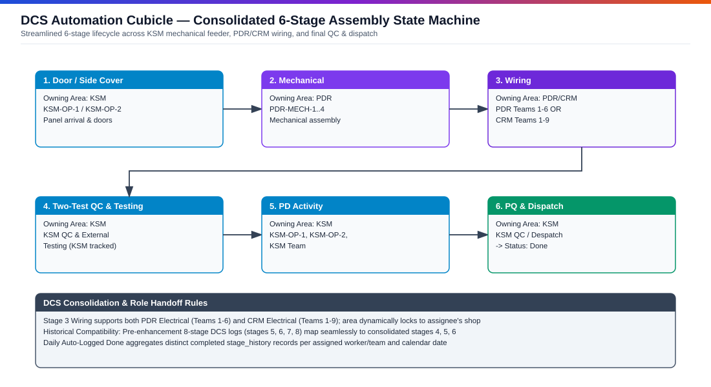
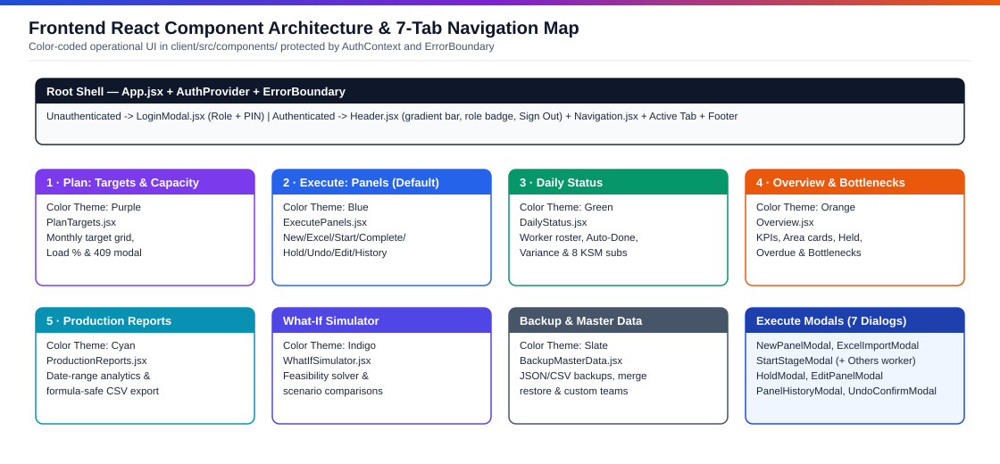
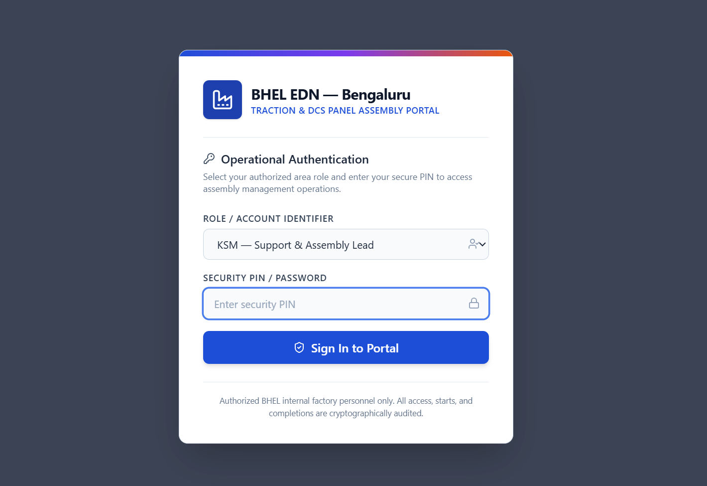
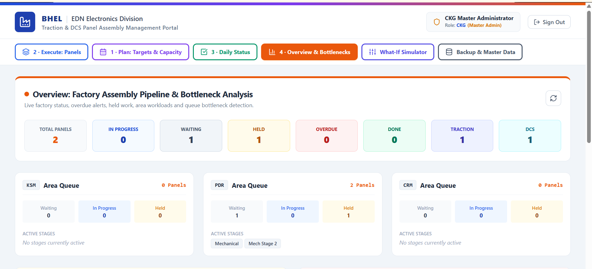
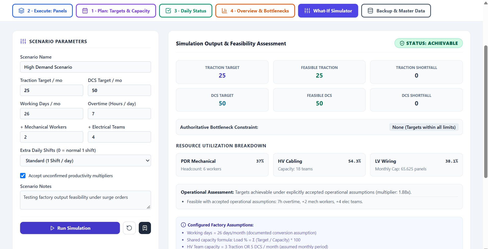
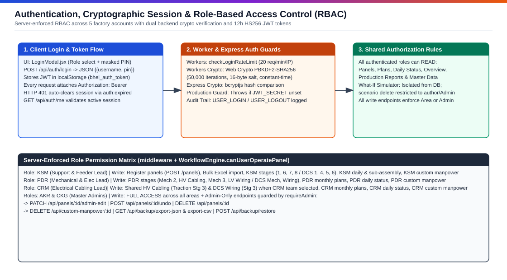
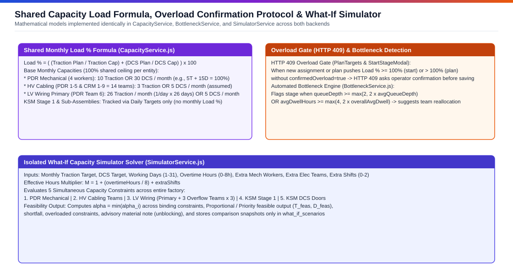

# BHEL — Traction & DCS Panel Assembly Management Portal

[](#architecture-overview)
[](#dual-backend-runtime-architecture)
[](#dual-backend-runtime-architecture)
[](#authentication--role-based-access-control)

An operational Manufacturing Execution System (MES), multi-stage assembly tracker, shared-capacity planner, and isolated What-If simulator built for **Traction Converter** and **Distributed Control System (DCS)** electrical panel assembly across three factory shop areas (**KSM**, **PDR**, **CRM**).

> **Attribution & Scope Notice:** Developed by [Likhith B](https://github.com/LikhithB05) during an industrial engineering internship at Bharat Heavy Electricals Limited (BHEL), Electronics Division (EDN), Bengaluru (`05 Oct – 19 Oct 2026`), and migrated to Cloudflare Workers + D1 (`26 Nov 2026`). This repository is prepared as a sanitized software engineering portfolio project; it is not an official corporate software distribution of BHEL.

---

## Live Deployment

- **Production Edge URL (Cloudflare Workers + D1):** `https://bhel-portal.likhithb2005.workers.dev/`
- **Health Endpoint:** `GET /health` returns HTTP `200` with live D1 database connectivity status (`{"status":"ok","database":"ok","runtime":"Cloudflare Workers + D1"}`).
- **Authentication Gate:** Public visitors see only the operational sign-in modal; unauthenticated requests to `/api/*` return HTTP `401 Unauthorized`. Credentials are never published in this repository.

---

## Industrial Problem & Software Solution

Multi-stage assembly of railway locomotive Traction Converters (e.g., WAG-9 / Vande Bharat projects) and DCS automation cubicles requires tight handoffs across three physical areas:

- **Cross-Shop Handoff Visibility:** Replaces manual job cards and disconnected spreadsheets with timestamped stage transitions across **KSM** (feeder prep, QC, post-test dressing, dispatch), **PDR** (mechanical framing, HV cabling, LV wiring), and **CRM** (electrical cabling harnesses).
- **Shared Capacity & Overload Prevention:** Because electrical and mechanical teams split time between Traction and DCS builds, the portal calculates combined monthly utilization in real time and enforces an **HTTP `409 Conflict` Overload Confirmation Gate** whenever assignments exceed `100%`.
- **Reversible Audit Governance:** Every login, stage start/completion, hold/resume, and restore writes to `audit_logs`, while Master Administrators (`AKR`, `CKG`) can safely reverse the last completed stage (`POST /api/panels/:id/undo`) when subsequent work has not yet started.
- **Isolated Scenario Simulation:** Production planners can test target feasibility against overtime, extra shifts, and additional headcount in a sandboxed **What-If Simulator** without mutating live production records.

---

## Architecture Overview



### Dual-Backend Runtime Architecture

The React 18 SPA (`client/`) works identically against **two parity-aligned backends**:

| Layer | Live Production Path (`worker/`) | Local / Container Path (`server/`) |
|---|---|---|
| **Runtime & Router** | Cloudflare Workers + Hono `4.6.14` | Node.js `>=22.5.0` (verified on `v24.19.0`) + Express `4.21.2` |
| **Static Assets** | Cloudflare Workers `[assets]` SPA binding | Express `express.static('client/dist')` single-port serving |
| **Database** | Cloudflare D1 Serverless SQLite (`0001_init.sql`) | Built-in `node:sqlite` (`DatabaseSync`, WAL mode, nested savepoints) |
| **Password Hashing** | Web Crypto `PBKDF2-SHA256` (`50,000` iters, `16`-byte salt) | `bcryptjs` (`10` salt rounds) |
| **Session Tokens** | Custom Web Crypto `HS256` JWT (`12h` expiry) | `jsonwebtoken` `HS256` (`12h` expiry) |
| **Edge Guards** | Per-isolate login rate limit (`20 req/60s/IP`), `X-Frame-Options: DENY` | CORS origin delegate, mandatory production `JWT_SECRET` check |

See [`docs/ARCHITECTURE.md`](docs/ARCHITECTURE.md) and [`docs/DEPLOYMENT_GUIDE.md`](docs/DEPLOYMENT_GUIDE.md).

---

## Consolidated Production Workflows

### Traction Converter Assembly — 8 Stages


### DCS Automation Panel — 6 Stages


`WorkflowEngine.getStageDefinition()` preserves backward compatibility for historical 10-stage Traction and 8-stage DCS records. All shop-floor personnel identifiers in this repository are anonymized (`KSM-OP-1..2`, `KSM-SUB-1..3`, `PDR-MECH-1..4`, `PDR-ELEC-T*`, `CRM-OP-*`). See [`docs/WORKFLOWS.md`](docs/WORKFLOWS.md).

---

## Application Modules (7 Color-Coded Navigation Tabs)



| Tab | Theme | Implemented Capabilities |
|---|---|---|
| **1 · Plan: Targets & Capacity** | Purple | Monthly Traction & DCS target entry per team/operator, live Load % indicator, HTTP `409` overload confirmation modal |
| **2 · Execute: Panels** *(Default)* | Blue | Single panel creation, bulk `.xlsx`/`.csv` import (`xlsx`), Start/Complete/Hold/Resume, `+ Others` custom workforce registration, Admin Edit/Delete/Undo, stage history timeline, overdue badges |
| **3 · Daily Status** | Green | Date-keyed operator targets & actuals, variance, achievement %, independent read-only **Auto-Logged Done** computed from `stage_history`, 8 KSM sub-assembly items |
| **4 · Overview & Bottlenecks** | Orange | Live KPI counts, area queue cards, held/overdue watchlists, automated bottleneck detection (`>= 2x` average queue depth or dwell time) |
| **5 · Production Reports** | Cyan | Multidimensional date-range stage & operator throughput analytics with formula-injection-safe CSV export |
| **What-If Simulator** | Indigo | Isolated 5-constraint capacity solver with overtime, extra shifts, added headcount, shortfall metrics, and saved scenario comparisons |
| **Backup & Master Data** | Slate | Live table counts, Admin-only full JSON backup, Panels CSV export, atomic ID-merge restore, custom manpower toggle/delete, workflow reference |

### Application UI Previews (Synthetic Demonstration Captures)

> *Note: Captures below were taken on synthetic demonstration data prior to adding the `5 · Production Reports` tab and bulk Excel import controls.*

| Login Gate | Overview KPIs | What-If Simulator (Achievable) |
|---|---|---|
|  |  |  |

Additional captures (`fig08_simulator_not_achievable.png`, `fig10_backup_master_data.png`) are available in [`assets/screenshots/`](assets/screenshots/).

---

## Authentication & Role-Based Access Control



All `/api/*` endpoints verify a `Bearer` JWT and enforce server-side area or admin authorization:
- **Area Leads (`KSM`, `PDR`, `CRM`):** Read access across dashboards; write access strictly scoped to their own shop's stages, monthly plans, daily status, and custom manpower (plus shared HV Cabling / DCS Wiring stages when assigning PDR or CRM teams).
- **Master Administrators (`AKR`, `CKG`):** Full operational authority plus admin-only endpoints (`admin-edit`, `undo`, `DELETE`, JSON/CSV backup export, and merge restore).

See [`docs/RBAC_SECURITY.md`](docs/RBAC_SECURITY.md).

---

## Capacity Mathematics & Database Schema



- **Shared Monthly Load %:** $\text{Load \%} = \left(\frac{\text{Traction Count}}{\text{Traction Cap}} + \frac{\text{DCS Count}}{\text{DCS Cap}}\right) \times 100$
- **Bottleneck Detection:** Flags stages where $\text{Queue Depth} \ge \max(2,\; 2 \times \overline{\text{Queue}})$ or $\text{Avg Dwell} \ge \max(4\text{h},\; 2 \times \overline{\text{Dwell}})$.
- **Database Schema:** 10 relational tables (`users`, `panels`, `stage_history`, `hold_history`, `monthly_plans`, `daily_status`, `sub_assembly`, `what_if_scenarios`, `audit_logs`, `custom_manpower`) and 13 indexes. See [`docs/DATABASE_SCHEMA.md`](docs/DATABASE_SCHEMA.md) and [`docs/diagrams/05_database_erd.svg`](docs/diagrams/05_database_erd.svg).

---

## Engineering Challenges & Solutions

1. **Cloudflare Workers `10 ms` CPU Limit on Auth:** Pure-JS `bcryptjs` exceeded free-tier Worker CPU limits during login. Migrated edge password verification to native Web Crypto `PBKDF2-SHA256` (`<1 ms`), while keeping `bcryptjs` in the Node.js Express server.
2. **Stage Consolidation Without Breaking Historical Data:** Streamlining Traction (`10 -> 8` stages) and DCS (`8 -> 6` stages) risked breaking existing `stage_history` rows. `WorkflowEngine.getStageDefinition()` maps legacy stage numbers transparently to consolidated definitions.
3. **Zero-Config Local Persistence Without Native C++ Addons:** Using Node.js built-in `node:sqlite` (`DatabaseSync` with WAL mode and nested savepoints) avoids native compilation issues (`better-sqlite3`/`node-gyp`) across Windows and Alpine Linux containers.

---

## Repository Structure

```text
.
├── client/                  # React 18 + Vite 6 + Tailwind CSS 3 SPA
├── server/                  # Express 4 + node:sqlite backend & 7 Node --test suites
├── worker/                  # Cloudflare Workers (Hono) + D1 schema (0001_init.sql)
├── docs/                    # 8 technical guides + 8 SVG architecture diagrams
├── assets/screenshots/      # Non-PII synthetic UI reference captures
├── Dockerfile               # Two-stage Node 22 Alpine container build
├── railway.json, render.yaml
└── .env.example, BACKUP_AND_RESTORE.md, DATABASE_MIGRATION.md, DEPLOYMENT.md
```

---

## Local Setup, Build & Verification

**Prerequisites:** Node.js `>= 22.5.0` and `npm`.

```bash
# 1. Install workspace dependencies
npm install

# 2. Configure environment variables (set a strong JWT_SECRET and custom SEED_PIN_* values)
cp .env.example .env

# 3. Initialize schema & local dev accounts (defaults to dev-*-pin if SEED_PIN_* unset)
npm run seed

# 4. Run Express API (http://localhost:5000) and Vite dev server (http://localhost:5173)
npm run server
npm run client

# 5. Production build & automated server tests (56/56 passing on isolated DBs)
npm run build
npm test
```

See [`docs/TESTING_AND_VERIFICATION.md`](docs/TESTING_AND_VERIFICATION.md) and [`DEPLOYMENT.md`](DEPLOYMENT.md) for Cloudflare Workers (`wrangler dev` / `wrangler deploy`) instructions.

---

## Known Limitations & Future Improvements

- **Known Limitations:** Shop-floor authentication uses role+PIN accounts rather than corporate LDAP/SSO; JWTs are stored in `localStorage` (`bhel_auth_token`); Express `server/` relies on reverse-proxy rate limiting (while `worker/` enforces per-isolate `20 req/60s` limits); material tracking covers 8 daily sub-assembly items rather than live SAP ERP integration; QC rework/rejection loops and external testing worker assignments remain deferred (`Factory Assumptions A6–A7`).
- **Future Scope:** Barcode/RFID panel check-in, `HttpOnly` cookie session hardening, configurable QC rejection transitions, and linear-programming shift scheduling in the What-If Simulator.

---

## Documentation Index

| Document | Focus |
|---|---|
| [`docs/ARCHITECTURE.md`](docs/ARCHITECTURE.md) | Dual-backend architecture, module layout & request lifecycle |
| [`docs/WORKFLOWS.md`](docs/WORKFLOWS.md) | Consolidated 8-stage Traction & 6-stage DCS workflows, holds & admin undo |
| [`docs/RBAC_SECURITY.md`](docs/RBAC_SECURITY.md) | Auth primitives, RBAC matrix, CSV formula defense & OWASP review |
| [`docs/API_REFERENCE.md`](docs/API_REFERENCE.md) | Complete REST API endpoints & status contracts (`400`/`401`/`403`/`409`) |
| [`docs/DATABASE_SCHEMA.md`](docs/DATABASE_SCHEMA.md) | 10-table SQLite/D1 schema, indexes & cascade rules |
| [`docs/CAPACITY_AND_SIMULATOR.md`](docs/CAPACITY_AND_SIMULATOR.md) | Shared Load % math, bottleneck thresholds & 5-constraint What-If solver |
| [`docs/DEPLOYMENT_GUIDE.md`](docs/DEPLOYMENT_GUIDE.md) | Cloudflare Workers + D1, Docker 2-stage build & Render/Railway profiles |
| [`docs/TESTING_AND_VERIFICATION.md`](docs/TESTING_AND_VERIFICATION.md) | Automated suite inventory (`56/56`) & live edge checks |
| [`AUTHORS.md`](AUTHORS.md) | Developer contribution ([Likhith B](https://github.com/LikhithB05)) & industrial mentorship |
