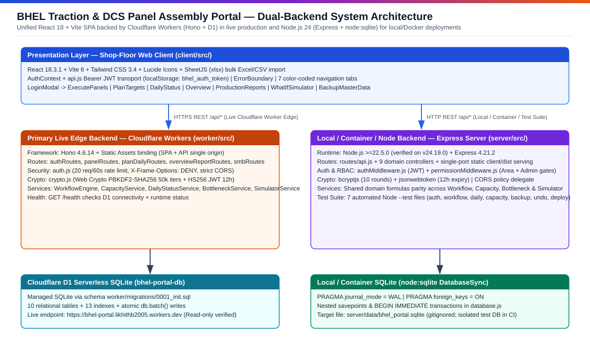

# System Architecture Reference



## 1. Monorepo Directory Structure

```
.
├── client/                  # React 18 + Vite 6 + Tailwind CSS 3 SPA
│   └── src/
│       ├── context/         # AuthContext.jsx (JWT hydration & auth:expired listener)
│       ├── utils/           # api.js (Bearer injection, error extraction, Blob downloads)
│       └── components/
│           ├── tabs/        # 7 operational tab views
│           └── *.jsx        # LoginModal, Header, Navigation, ErrorBoundary, 7 operation modals
├── server/                  # Local / Self-hosted Express 4 + node:sqlite backend
│   ├── src/
│   │   ├── auth/            # authController.js (bcrypt + jsonwebtoken)
│   │   ├── config/          # env.js (PORT, CLIENT_ORIGIN, DB_PATH, JWT_SECRET guard)
│   │   ├── controllers/     # 9 HTTP route controllers
│   │   ├── data/            # masterData.js (shops, teams, stages, assumptions)
│   │   ├── db/              # database.js (WAL + savepoint wrapper) & seed.js
│   │   ├── middleware/      # authMiddleware.js & permissionMiddleware.js
│   │   ├── routes/          # api.js
│   │   └── services/        # WorkflowEngine, CapacityService, DailyStatusService, BottleneckService, SimulatorService
│   └── tests/               # 7 Node.js native --test integration suites
├── worker/                  # Active Cloudflare Workers + Hono + D1 edge backend
│   ├── migrations/          # 0001_init.sql schema
│   ├── scripts/             # export-sqlite-to-d1.mjs migration helper
│   ├── src/
│   │   ├── routes/          # authRoutes, panelRoutes, planDailyRoutes, overviewReportRoutes, smbRoutes
│   │   ├── middleware/      # auth.js (JWT + per-isolate login rate limiter)
│   │   ├── utils/           # crypto.js (Web Crypto PBKDF2-SHA256 + HS256 JWT)
│   │   ├── data/            # masterData.js
│   │   └── services/        # Parity implementations adapted for async D1 queries
│   ├── tests/               # e2e_verify.mjs live/local Wrangler check
│   └── wrangler.toml        # Workers Static Assets + D1 binding config (sanitized ID)
└── docs/                    # Architecture, workflow, security, API, schema & deployment guides
```

## 2. Frontend Request & State Lifecycle

1. `AuthProvider` (`client/src/context/AuthContext.jsx`) initializes from `localStorage` (`bhel_auth_token`, `bhel_auth_user`) and calls `GET /api/auth/me` on boot.
2. Unauthenticated users render `LoginModal` exclusively; no dashboard tabs or operational tables render before authentication succeeds.
3. Authenticated sessions fetch `/api/master-data` once in `Dashboard`, render `Header`, `Navigation`, and default to `ExecutePanels` (`2 · Execute: Panels`), wrapped in `ErrorBoundary`.
4. All mutations flow through `client/src/utils/api.js` using relative `/api/*` requests, ensuring zero CORS issues on single-origin Cloudflare Workers (`ASSETS` binding) and single-port Express (`client/dist` static serving).

