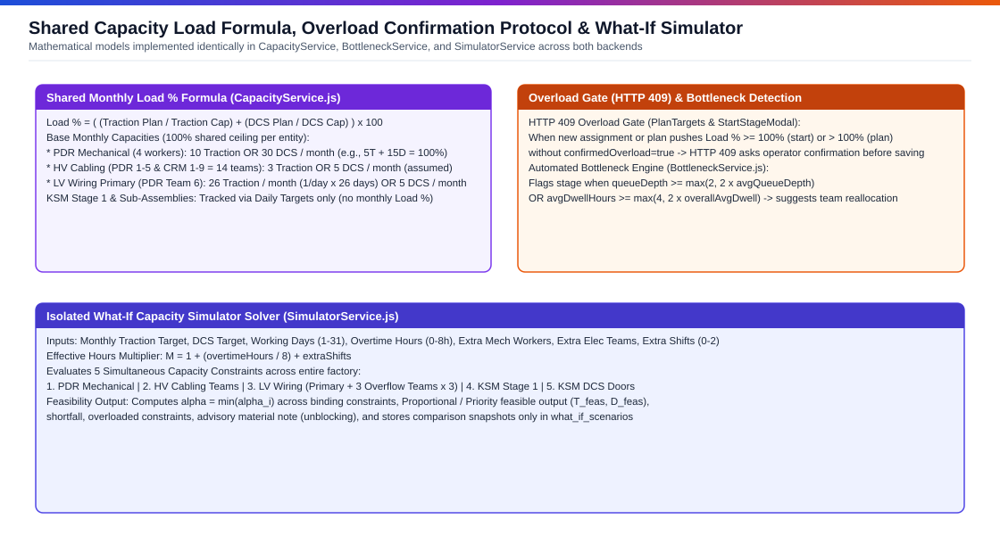

# Capacity Modeling, Bottleneck Analytics & What-If Simulator

## 1. Shared Load % Model (`CapacityService`)

Every monthly-planned entity (4 PDR Mechanical personnel, 6 PDR Electrical teams, 9 CRM Electrical teams) operates against shared Traction and DCS capacity ceilings:

$$\text{Load \%} = \text{round}_1\left(\left(\frac{\text{Traction Count}}{C_T} + \frac{\text{DCS Count}}{C_D}\right) \times 100\right)$$

- **PDR Mechanical (`PDR-MECH-1`, `PDR-MECH-2`, `PDR-MECH-3`, `PDR-MECH-4`):** $C_T = 10$/mo, $C_D = 30$/mo (e.g., 5 Traction + 15 DCS = 100%).
- **HV Electrical Teams (`PDR Team 1–5`, `CRM Team 1–9`):** $C_T = 3$/mo, $C_D = 5$/mo (*assumed monthly basis per Factory Assumptions A1*).
- **LV Wiring Primary (`PDR Team 6`):** $C_T = 26$/mo (`1/day * 26 working days`), $C_D = 5$/mo.
- **KSM Stage 1 & Sub-Assemblies:** Tracked via daily targets (`KSM-OP-1`, `KSM-OP-2`, 8 sub-assemblies), not monthly Load %.

## 2. Bottleneck Detection (`BottleneckService`)

Evaluates active (`status != 'Done'`) queues and observed `stage_history` durations:
- **Queue Bottleneck:** $\text{queueDepth} \ge \max(2,\; 2 \times \overline{\text{queueDepth}})$
- **Dwell Bottleneck:** $\text{stageAvgDwell} \ge \max(4\text{h},\; 2 \times \overline{\text{dwell}})$
- Generates targeted reallocation recommendations (e.g., overflowing Traction Stage 5 LV Wiring to `PDR Team 3–5`, or Traction Stage 3 HV Cabling across `CRM Team 1–9`).

## 3. Isolated What-If Simulator (`SimulatorService`)

Simulates monthly factory throughput under 5 simultaneous resource constraints (`PDR Mechanical`, `HV Cabling`, `LV Wiring`, `KSM Stage 1`, `KSM DCS Doors`) scaled by:

$$M = 1 + \frac{\text{overtimeHours}}{8} + \text{extraShifts}$$

Bounds enforced by controller validation: `workingDays` in `[1, 31]`, `overtimeHours` in `[0, 8]`, `extraShifts` in `[0, 2]`, `additionalMechanicalWorkers` & `additionalElectricalTeams` in `[0, 50]`, targets in `[0, 10000]`. Evaluates exact feasible integer pairs, target shortfalls, and non-blocking sub-assembly supply advisories.

