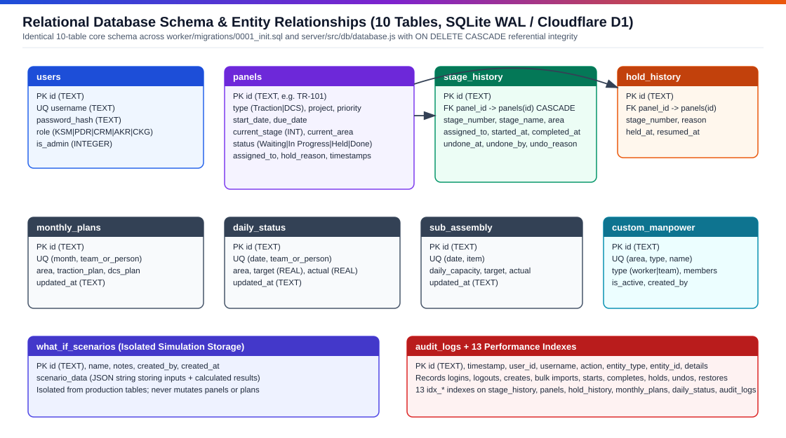

# Database Schema & Indexing Reference

Both `worker/migrations/0001_init.sql` (Cloudflare D1) and `server/src/db/database.js` (`node:sqlite` `DatabaseSync` with `PRAGMA journal_mode = WAL` and `PRAGMA foreign_keys = ON`) share an identical **10-table** relational schema and **13 performance indexes**:

| Table | Purpose | Key Constraints |
|---|---|---|
| `users` | Role accounts (`KSM`, `PDR`, `CRM`, `AKR`, `CKG`) | `username UNIQUE`, `role CHECK(...)`, `password_hash` (`PBKDF2` in D1 / `bcrypt` in Express) |
| `panels` | Active & completed assembly units | `type CHECK('Traction','DCS')`, `priority`, `status CHECK('Waiting','In Progress','Held','Done')` |
| `stage_history` | Per-stage execution & undo trail | `panel_id REFERENCES panels(id) ON DELETE CASCADE`; stores `undone_at`, `undone_by`, `undo_reason` |
| `hold_history` | Interruption intervals & reasons | `panel_id REFERENCES panels(id) ON DELETE CASCADE` |
| `monthly_plans` | Monthly Traction/DCS plans by resource | `UNIQUE(month, team_or_person)` enabling atomic `ON CONFLICT DO UPDATE` |
| `daily_status` | Daily shift targets & manual actuals | `UNIQUE(date, team_or_person)` |
| `sub_assembly` | Daily KSM feeder prep (8 components) | `UNIQUE(date, item)` |
| `what_if_scenarios` | Saved simulator inputs & outputs (JSON) | Isolated from transactional production tables |
| `audit_logs` | Immutable operational event stream | Logs logins, logouts, CRUD, stage transitions, undos, custom manpower & backup restores |
| `custom_manpower` | Dynamic `+ Others` operators/teams | `UNIQUE(area, type, name)`, `is_active` toggle |

See [`DATABASE_MIGRATION.md`](../DATABASE_MIGRATION.md) for historical Railway SQLite-to-D1 migration architecture.

