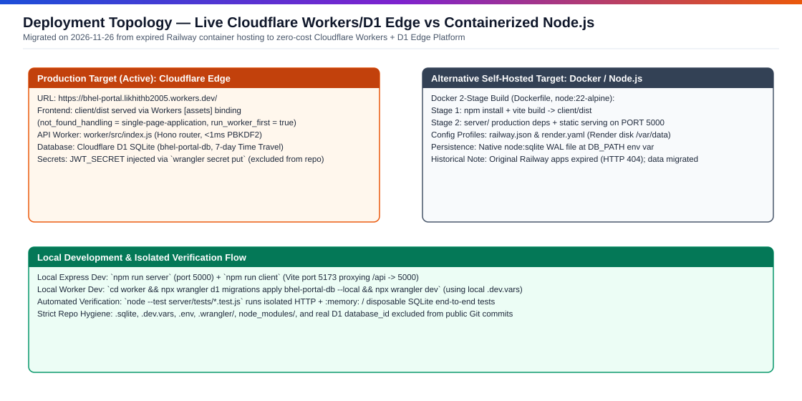

# Deployment & Operations Guide

## 1. Cloudflare Workers + D1 Edge Deployment (`worker/`)

1. Authenticate Wrangler CLI (`npx wrangler login`).
2. Provision D1 database (`npx wrangler d1 create bhel-portal-db`) and replace `<YOUR_CLOUDFLARE_D1_DATABASE_ID>` in `worker/wrangler.toml`.
3. Build client bundle (`npm run build`) so `client/dist/` exists for `[assets]` binding.
4. Apply schema migration (`cd worker && npx wrangler d1 migrations apply bhel-portal-db --remote`).
5. Provision secrets via Wrangler (`npx wrangler secret put JWT_SECRET`) and seed user accounts with rotated production PINs (`PBKDF2-SHA256` hashes via `worker/scripts/export-sqlite-to-d1.mjs` or admin SQL).
6. Deploy (`cd worker && npx wrangler deploy`).

## 2. Docker / Node.js Container Deployment

`Dockerfile` defines a two-stage `node:22-alpine` build:
- **Stage 1 (`frontend-builder`):** Installs `client/` dependencies and builds `client/dist/`.
- **Stage 2 (`runner`):** Installs production `server/` dependencies, sets `ENV NODE_ENV=production` and `ENV PORT=5000`, and mounts persistent SQLite storage at `DB_PATH` (`/app/server/data/bhel_portal.sqlite`).
- Reference configurations are included in `railway.json` and `render.yaml` (`/var/data` persistent disk).

