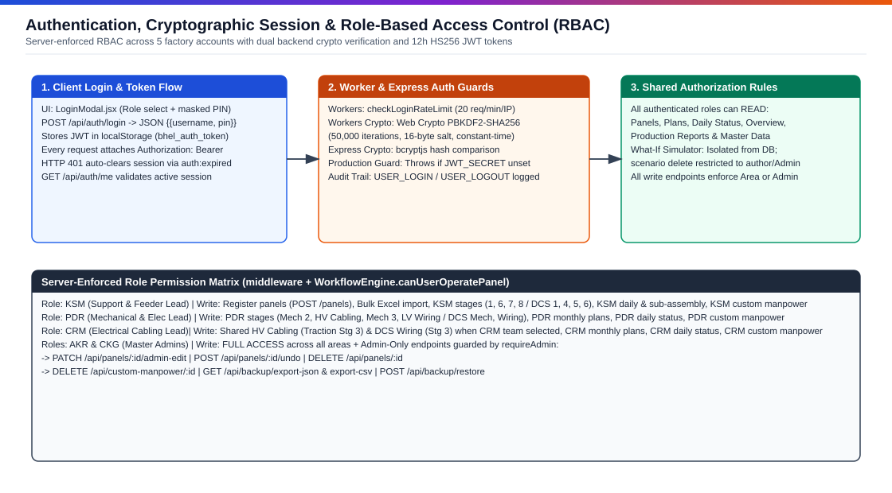

# Authentication, RBAC & Security Controls

## 1. Cryptographic Design

- **Cloudflare Workers (`worker/src/utils/crypto.js`):** Uses Web Crypto API `PBKDF2-SHA256` (`50,000` iterations, `16`-byte random salt, constant-time byte comparison) stored as `$pbkdf2-sha256$50000$<saltHex>$<hashHex>`, chosen so login verification fits comfortably within Cloudflare Workers free-tier CPU limits (`<1 ms` vs bcrypt's high JS CPU overhead).
- **Express Node Server (`server/src/auth/authController.js`):** Uses `bcryptjs` (10 salt rounds) + `jsonwebtoken`.
- **Session Tokens:** Signed `HS256` JWTs with `12h` expiry carrying `{ id, username, role, isAdmin, displayName }`. Both backends throw a fatal startup/auth error if `NODE_ENV=production` and `JWT_SECRET` is missing or left at an insecure dev default.

## 2. Role-Based Authorization Matrix

| Operation / Endpoint Group | `KSM` | `PDR` | `CRM` | `AKR` / `CKG` |
|---|---|---|---|---|
| Read Panels, Plans, Daily Status, Overview, Reports, Master Data | Yes | Yes | Yes | Yes |
| Register New Panel / Bulk Excel Import | Yes | No (`403`) | No (`403`) | Yes |
| Start / Complete / Hold / Resume Stage | KSM stages | PDR stages + shared HV/Wiring | Shared HV/Wiring (CRM teams) | Yes (All) |
| Save Monthly Plan Targets | KSM (none editable) | PDR tables | CRM tables | Yes (All) |
| Update Daily Status Targets & Actuals | KSM roster | PDR roster | CRM roster | Yes (All) |
| Update KSM Sub-Assemblies | Yes | No (`403`) | No (`403`) | Yes |
| Register Custom Manpower (`+ Others`) | KSM only | PDR only | CRM only | Yes (All) |
| Admin Edit (`PATCH /admin-edit`), Undo (`/undo`), Delete (`DELETE`) | No (`403`) | No (`403`) | No (`403`) | Yes |
| Export JSON/CSV Backup & Safe Merge Restore | No (`403`) | No (`403`) | No (`403`) | Yes |

## 3. Implemented Defenses & Known Trade-Offs

- **Security Headers (`worker/src/index.js`):** Sets `X-Content-Type-Options: nosniff`, `X-Frame-Options: DENY`, and `Referrer-Policy: strict-origin-when-cross-origin`.
- **CSV Formula Injection Defense:** Both `overviewReportRoutes.js` / `reportController.js` and `smbRoutes.js` / `backupController.js` prefix cells matching `/^[\=\+\-\@\t\r]/` with a leading `'`.
- **Login Brute-Force Mitigation:** Worker `authRoutes.js` enforces an in-isolate sliding-window rate limiter (`20` attempts per `60s` per IP returning HTTP `429`); the Express backend currently relies on upstream/reverse-proxy rate limiting (`authController.js` has no in-app rate limiter).
- **Token Storage Trade-Off:** JWTs are persisted in `localStorage` (`bhel_auth_token`) for SPA simplicity; deployments should serve over HTTPS behind strict CSP to prevent XSS token exposure.

