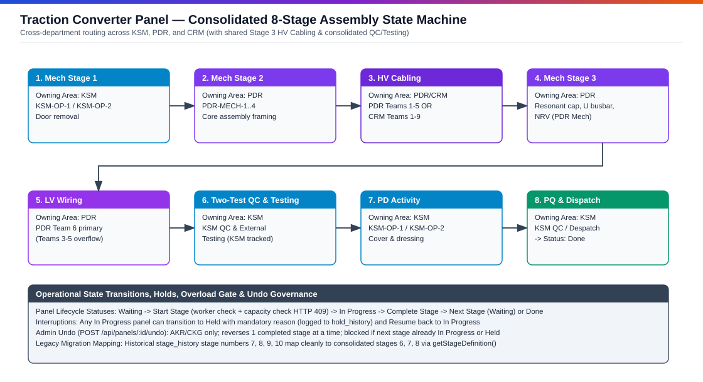
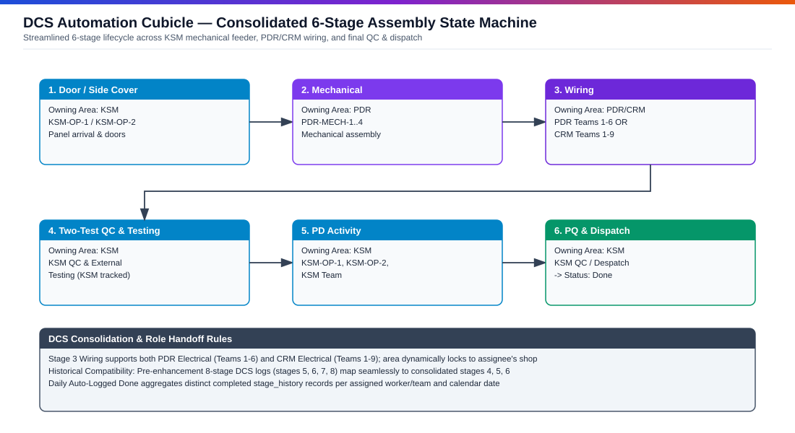

# Production Workflows & State Machine Specification

## 1. Consolidated Traction Converter Workflow (8 Stages)

| Stage # | Stage Name | Owning Area | Eligible Personnel / Teams | Operational Notes |
|---|---|---|---|---|
| 1 | Mech Stage 1 | KSM | `KSM-OP-1`, `KSM-OP-2` | Door removal and feeder mechanical prep |
| 2 | Mech Stage 2 | PDR | `PDR-MECH-1`, `PDR-MECH-2`, `PDR-MECH-3`, `PDR-MECH-4` | Core assembly framing in PDR |
| 3 | HV Cabling | PDR / CRM | `PDR Team 1–5`, `CRM Team 1–9` | Area dynamically tracks assigned PDR/CRM team |
| 4 | Mech Stage 3 | PDR | `PDR-MECH-1`, `PDR-MECH-2`, `PDR-MECH-3`, `PDR-MECH-4` | Resonant cap loading, U busbar, NRV |
| 5 | LV Wiring | PDR | `PDR Team 6` (primary), `PDR Team 3–5` | Primary Team 6; Teams 3–5 for high load |
| 6 | Two-Test QC & Testing | KSM | `KSM QC`, `Testing Team (KSM Tracked)` | Consolidated QC and external testing handoff |
| 7 | PD Activity | KSM | `KSM-OP-1`, `KSM-OP-2` | Channel cover, dressing, door & side covers |
| 8 | PQ & Dispatch | KSM | `KSM QC`, `KSM Despatch` | Pre-despatch QC & final completion (`Done`) |

## 2. Consolidated DCS Panel Workflow (6 Stages)

| Stage # | Stage Name | Owning Area | Eligible Personnel / Teams |
|---|---|---|---|
| 1 | Door / Side Cover | KSM | `KSM-OP-1`, `KSM-OP-2` |
| 2 | Mechanical | PDR | `PDR-MECH-1`, `PDR-MECH-2`, `PDR-MECH-3`, `PDR-MECH-4` |
| 3 | Wiring | PDR / CRM | `PDR Team 1–6`, `CRM Team 1–9` |
| 4 | Two-Test QC & Testing | KSM | `KSM QC`, `Testing Team (KSM Tracked)` |
| 5 | PD Activity | KSM | `KSM-OP-1`, `KSM-OP-2`, `KSM Team` |
| 6 | PQ & Dispatch | KSM | `KSM QC`, `KSM Despatch` |

## 3. Historical Compatibility & Reversibility (`WorkflowEngine.js`)

- **Legacy Stage Number Mapping:** Existing database rows using the earlier 10-stage Traction (`7 -> 6`, `8 -> 7`, `9/10 -> 8`) or 8-stage DCS (`5 -> 4`, `6 -> 5`, `7/8 -> 6`) indices resolve transparently via `WorkflowEngine.getStageDefinition()`.
- **Hold & Resume:** Any `In Progress` panel can move to `Held` with a mandatory non-empty `reason` logged in `hold_history`; resuming restores `In Progress` and timestamps `resumed_at`.
- **Admin Undo Governance (`POST /api/panels/:id/undo`):** Restricted to `AKR`/`CKG`. Finds the latest un-undone completed `stage_history` row and restores the panel to that stage in `Waiting` status while recording `undone_at`, `undone_by`, and `undo_reason`. Refuses reversal if the subsequent stage is already `In Progress` or `Held`.

